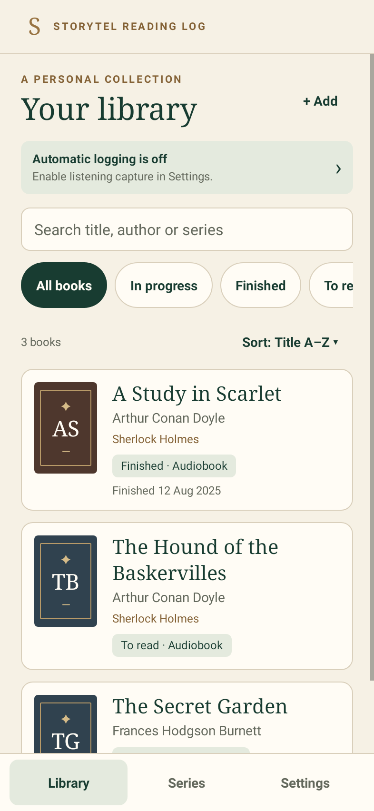
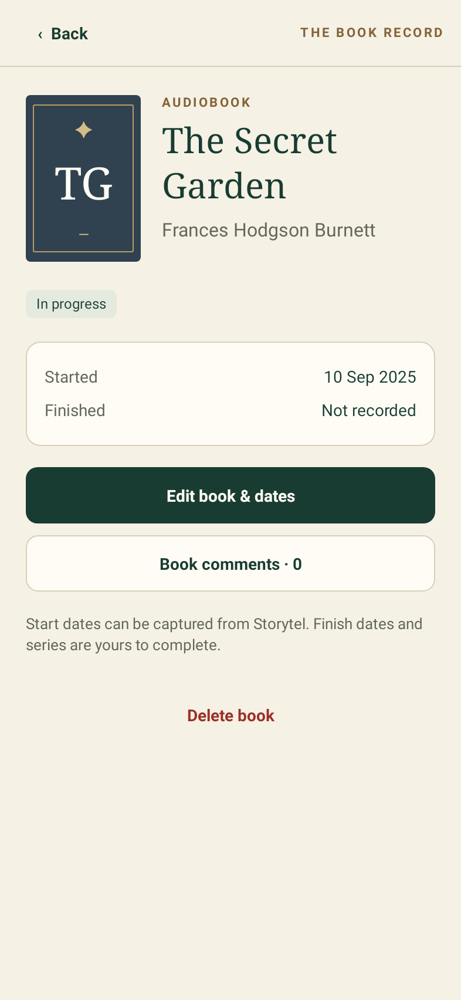
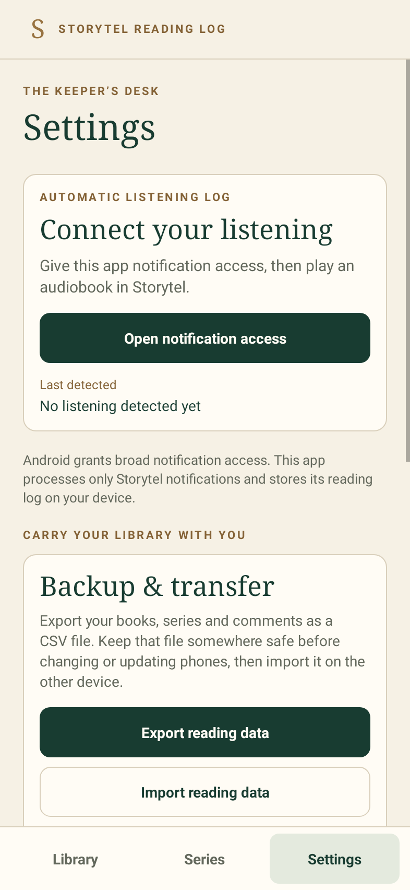

<div align="center">

# Storytel Reading Log

**A personal reading journal, with a little Victorian elegance.**

An unofficial Android companion that turns Storytel playback notifications into a listening history.

[](https://github.com/rthorman/storytel-reading-log/actions/workflows/android.yml)
[](docs/INSTALL.md)
[](LICENSE)

**[Download APK](https://github.com/rthorman/storytel-reading-log/releases/latest/download/storytel-reading-log.apk)** · **[Download APK ZIP](https://github.com/rthorman/storytel-reading-log/releases/latest/download/storytel-reading-log.zip)** · [All releases](https://github.com/rthorman/storytel-reading-log/releases)

</div>

## Install and start logging on your Android phone

1. **Download the APK above on your phone.** If you choose the ZIP, extract it in Files first.
2. **Tap the APK to install.** If prompted, open Settings and allow your browser or Files app to **install unknown apps**, then return to install. You can disable that installation permission afterward.
3. **Open Storytel Reading Log → Settings → Open notification access.** Enable **Storytel reading log automation**. If Android blocks access, open Android **Settings → Apps → Storytel Reading Log → ⋮ → Allow restricted settings**, then try notification access again. Some phones omit this step.
4. **Allow background operation.** In Android **Settings → Apps → Storytel Reading Log → Battery**, choose **Unrestricted** or allow background usage where available. Allow **Storytel notifications** too.
5. **Play an audiobook in Storytel.** Check that its playback notification appears, then return to the journal’s **Library**. The book and its first detected listening date should appear. Review the title and author.

**Requires Android 8.0 or newer. This is an early, sideloaded prototype.** Series, ebook activity and finish dates currently need manual entry. Before changing phones or uninstalling, use **Settings → Export reading data** to save a CSV backup. Read the [installation and troubleshooting guide](docs/INSTALL.md) if Android rejects an update.

## A quieter place for your reading life

<p align="center">
  
</p>

Ivory paper, bottle-green accents, antique-brass details and serif typography give the journal the feel of a personal library. The illustration was generated for this project. Decorative bookplates use initials rather than pretending to be real book-cover artwork.

| Library | Book details | Settings |
| --- | --- | --- |
|  |  |  |

Screenshots use demonstration books; no personal reading history is included.

## What it does

- **Automatic listening capture:** records a book and its first observed listening date from Storytel’s Android playback notification.
- **A searchable library:** find books by title, author or series; sort by those fields or by start date; filter by reading status.
- **Books and series:** edit metadata and dates, group books into series, and keep separate comments on each.
- **CSV backup and restore:** move books, series, dates and comments between phones in one readable file, with validation before restoring.
- **Useful diagnostics:** export timestamped notification fields, playback metadata, capture decisions and errors.
- **Local storage:** SQLite on your phone, with no account, analytics, server or Internet permission.

## Back up or move to another phone

On the old phone, choose **Settings → Export reading data** and save the CSV somewhere outside the app. Transfer it using Quick Share, USB or your preferred file service. On the new phone, install the app and choose **Settings → Import reading data**. Select the CSV, review the record counts and confirm the restore.

**Restore replaces the receiving phone’s existing books, series and comments. Export those first if you want to keep them.** The entire file is validated before changes are offered, and restore runs in one database transaction. It does not merge two libraries. [CSV format and backup guide](docs/BACKUPS.md).

## How automation works—and its limits

With notification access enabled, the listener processes only `grit.storytel.app` and `com.storytel.app` notifications. It prefers media metadata and falls back to notification title/text. A reported media session must be playing; without session metadata, an ongoing notification is accepted. Active notifications are checked when the listener connects.

Repeated notifications for the same title and author are matched to the existing book. Its first observed date becomes the start date. **A paused player, removed notification or chapter ending never marks a book finished.** Android notification access is broad, but other apps’ notifications are ignored by this app.

Storytel may expose chapter names or narrators instead of book details. Different metadata can create a separate entry; titles and authors remain editable. Capture cannot recover earlier activity, derive series reliably, detect ebook reading or establish whole-book completion reliably. Re-reading sessions are not tracked separately yet. Notification access, battery restrictions and your Storytel version affect capture.

## When something goes wrong

Enable **Settings → Debug mode**, reproduce the issue, then choose **Export debug log**. Debug mode is off by default. For a clean trace, use **Clear debug history** before reproducing it. [Diagnostics and privacy](docs/DIAGNOSTICS.md) explains the contents and useful reporting details.

**Logs and CSV backups contain personal reading details. Review them before attaching them to a public issue.** Nothing uploads automatically. Android cloud backup is disabled; save CSV backups yourself. A debug export is not a database backup.

## Build from source

Use **JDK 17**, **Gradle 8.9**, and **Android SDK 35**. Open this directory in Android Studio, or run:

```sh
bash scripts/test.sh
gradle testDebugUnitTest lint assembleRelease
adb install -r app/build/outputs/apk/release/app-release.apk
```

This source does not include a downloaded Gradle wrapper binary. Generate one with `gradle wrapper --gradle-version 8.9` if desired. Production code uses native Android APIs and Java; Robolectric and JUnit verify UI and storage behavior. GitHub Actions runs checks and uploads the APK and UI captures. [Verification notes](VERIFICATION.md) describe the practical limits of testing.

## Releases and project status

Downloadable APK and ZIP files are attached to [GitHub Releases](https://github.com/rthorman/storytel-reading-log/releases). Development builds are also available as short-lived [Actions artifacts](https://github.com/rthorman/storytel-reading-log/actions/workflows/android.yml). This project is public; personal reading history and debug logs are not part of the repository.

This is an independent prototype, not affiliated with or endorsed by Storytel. Real-device testing with Storytel remains essential. Improvements and reproducible bug reports are welcome through [Issues](https://github.com/rthorman/storytel-reading-log/issues).

## License

Copyright © 2026 Rickard Thorman. Licensed under the **GNU Affero General Public License, version 3 or later** (`AGPL-3.0-or-later`). See [LICENSE](LICENSE). The license applies to the project’s source and project-authored materials; third-party dependencies retain their own licenses. The library illustration was generated using OpenAI image generation; see [art credits](docs/ART.md).
